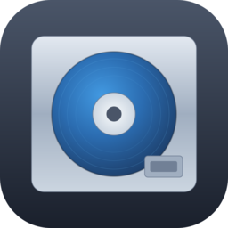
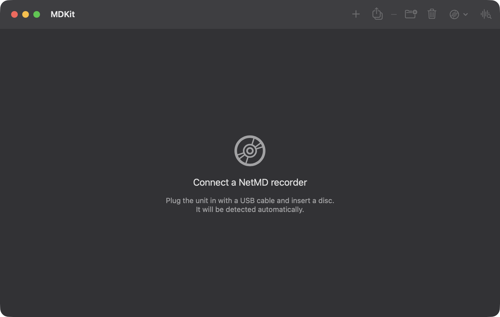

<p align="center">
  
</p>

<h1 align="center">MDKit</h1>

<p align="center">
  A native macOS app for <b>NetMD</b> MiniDisc recorders — write music to a disc, manage tracks and groups,<br>
  and pull audio back off decks that were never meant to support it.
</p>

<p align="center">
  
</p>

---

MDKit is a from-scratch Swift port of the device layer behind [Web MiniDisc Pro](https://github.com/asivery/webminidisc)
and [netmd-js](https://github.com/cybercase/netmd-js) — no browser, no WebUSB, no Chromium. It talks to the recorder
directly over USB via libusb and runs as a normal, self-contained Mac app.

It also includes **homebrew mode ripping**, ported from [netmd-exploits](https://github.com/asivery/netmd-exploits):
reading tracks *back off* a disc on decks that don't support NetMD's standard download command (every NetMD unit
except the Sony MZ-RH1/M200), by patching the recorder's own firmware in RAM to stream raw sector data out over USB.
The patches are volatile — they live only in the deck's RAM and vanish on their own the moment it's unplugged or
power-cycled, so there's nothing to "undo" and nothing persists if anything goes wrong.

## Features

**Writing to disc**
- Detects and connects to any NetMD unit in the netmd-js device table automatically over USB
- Upload in **SP** (PCM), **LP2** and **LP4** (ATRAC3, encoded with a bundled build of
  [atracdenc](https://github.com/dcherednik/atracdenc)) — drag and drop, a proper queue, ⌘O to add files
- Reads any audio format macOS can decode natively (MP3, AAC, FLAC, ALAC, WAV, AIFF…), plus Ogg/Opus if `ffmpeg`
  is installed; pre-encoded ATRAC3 `.wav`/`.at3` files are sent through unchanged
- Rename the disc, tracks, and groups; create, remove, and reorder groups; move tracks between them; delete tracks;
  erase or eject the disc
- Playback controls (play / pause / stop / prev / next, double-click a track to jump to it)

**Reading from disc — homebrew mode ripping**
- Works on any deck in netmd-exploits' Type-S or Type-R firmware compatibility list (see
  [`HomebrewRipper.supportedVersions`](Sources/NetMDKit/HomebrewRipper.swift)) — most consumer NetMD portables and
  decks from roughly 2001 onward, not just the MZ-RH1
- Automatically prefers the fast control-transfer backend (a single USB transfer per sector) on Type-S firmware,
  falling back to a slower but broader-compatibility backend elsewhere
- SP tracks are recovered as ATRAC1; if `ffmpeg` is installed (and was built with ATRAC1 support, which Homebrew's
  default build is) they're automatically decoded to a directly-playable WAV, since nothing in macOS reads raw AEA
  natively
- Detects and works around bad/misaligned sectors by reseeking and realigning mid-track

## Not (yet) included

Hi-MD, the control-transfer backend for Type-R firmware (netmd-exploits reports it as unstable there, so this stays
off), Remote NetMD, mono SP upload, song recognition, and the bulk-transfer ripping backend (HiMD-only upstream).
The protocol code for the MZ-RH1's *standard* track-download command exists (`NetMDInterface.saveTrack`) but has no
UI — homebrew mode ripping covers that use case for every deck now, including the RH1 itself.

## Building

Releases are Apple Silicon (arm64) only `.zip`/`.dmg` files on the
[Releases page](https://github.com/thebitstick/MDKit/releases). To build from source, you need Xcode or the Swift 5.9+ toolchain, CMake, and Homebrew.

```sh
brew install libusb keystone cmake
./Scripts/build-app.sh      # builds atracdenc (first run only) + the .app into build/
open "build/MDKit.app"
```

The app is ad-hoc signed (there's no paid Apple Developer account behind it), so Gatekeeper will block the first
launch. Right-click the app in Finder and choose **Open** (or allow it in System Settings → Privacy & Security
after the first blocked attempt) to run it anyway.

To produce distributable archives (`build/release/MDKit-<version>-<arch>.zip`, `.dmg`, and `SHA256SUMS.txt`):

```sh
Scripts/package.sh
```

Pushing a `v*` tag runs the release workflow, which tests, packages, and attaches those files to a GitHub release.

```sh
swift test                  # protocol codec, DES, titles, ARM assembler, ATRAC decode — no hardware needed
```

Notes:
- **Apple Silicon only.** Homebrew's `libusb`/`keystone` bottles are single-arch and the project is only tested on
  arm64. Intel Macs aren't supported.
- `LIBUSB_PREFIX=/usr/local` / `KEYSTONE_PREFIX=/usr/local/opt/keystone` override the default `/opt/homebrew`
  locations, e.g. for a non-Homebrew install.
- `Scripts/build-atracdenc.sh` builds [atracdenc](https://github.com/dcherednik/atracdenc) as an arm64 binary with
  a small built-in WAV reader/writer (`Vendor/patches/pcm_io_wav16.cpp`) in place of libsndfile, so the bundled
  encoder has no dylib dependencies of its own.

## How homebrew mode ripping works

NetMD's standard protocol only exposes a track-download command on the MZ-RH1/M200 — every other deck can take
music but not give it back. netmd-exploits found a way around that: Sony left a factory-mode debug interface enabled
on consumer firmware (used by SonicStage's own diagnostic tools), which can read and write the deck's RAM directly.

MDKit assembles a small ARM/THUMB program at runtime (via [Keystone](https://github.com/keystone-engine/keystone),
linked in statically) for the deck's *exact* firmware version, and uses it to redirect the firmware's own
sector-streaming routine to serve raw ATRAC data instead of its normal response, only while a rip is in progress.
Everything involved lives in RAM: nothing is written to the deck's EEPROM, and the moment it loses power the patches
are gone, firmware back to stock.

Open **Disc → Homebrew Ripping…** with a disc inserted; the app checks compatibility automatically and reports the
detected firmware version, or a clear reason if your particular unit isn't one it knows about yet — easy to extend
if you can get the right addresses for your deck's firmware via netmd-exploits' own compatibility notes.

## Layout

```
Sources/NetMDKit   protocol library — USB transport, NetMD command set, factory-mode commands,
                   firmware patch assembly, DES/3DES, title encoding, homebrew-mode ripping
Sources/MDKit      the SwiftUI app (DeviceController serialises all USB I/O onto one queue)
Tests/             everything testable without hardware: query codec round-trips, DES known-answer
                   vectors, title sanitizing, ARM assembly for every known firmware version, group
                   compilation, ATRAC1→WAV decoding
```

## Status

Built and iterated against real hardware (a Sony NetMD deck) for both writing and homebrew-mode ripping — both are
confirmed working end to end, including full-track rips. That said, this is a small, single-device test matrix
against a protocol with a lot of device-specific quirks across 25+ years of NetMD hardware; if something misbehaves
on your particular deck, please open an issue with the exact model and, if ripping is involved, the detected
firmware version string shown in the Homebrew Ripping panel.

As ever with anything that pokes at a device's factory mode: try it with a disc and a deck you don't mind risking
first. The ripping patches are RAM-only and self-clear on disconnect, but this is still low-level, reverse-engineered
protocol work.

## Contributing

Issues and pull requests are welcome. `swift test` needs no hardware and runs in CI on every push. If you have a
deck that isn't in the firmware tables yet, the most useful thing is the model and the version string the Homebrew
Ripping panel reports. See [AI-DISCLOSURE.md](AI-DISCLOSURE.md) for how this project was built.

## License

GPL-2.0 ([LICENSE.md](LICENSE.md)), matching upstream Web MiniDisc Pro. Bundled/linked components: atracdenc (LGPL-2.1), libusb (LGPL-2.1),
Keystone (BSD-3-Clause). NetMD protocol logic ported from Web MiniDisc Pro / netmd-js by asivery and Stefano Brilli;
homebrew-mode ripping ported from netmd-exploits and netmd-tocmanip by asivery. See
[THIRD-PARTY-NOTICES.md](THIRD-PARTY-NOTICES.md).
